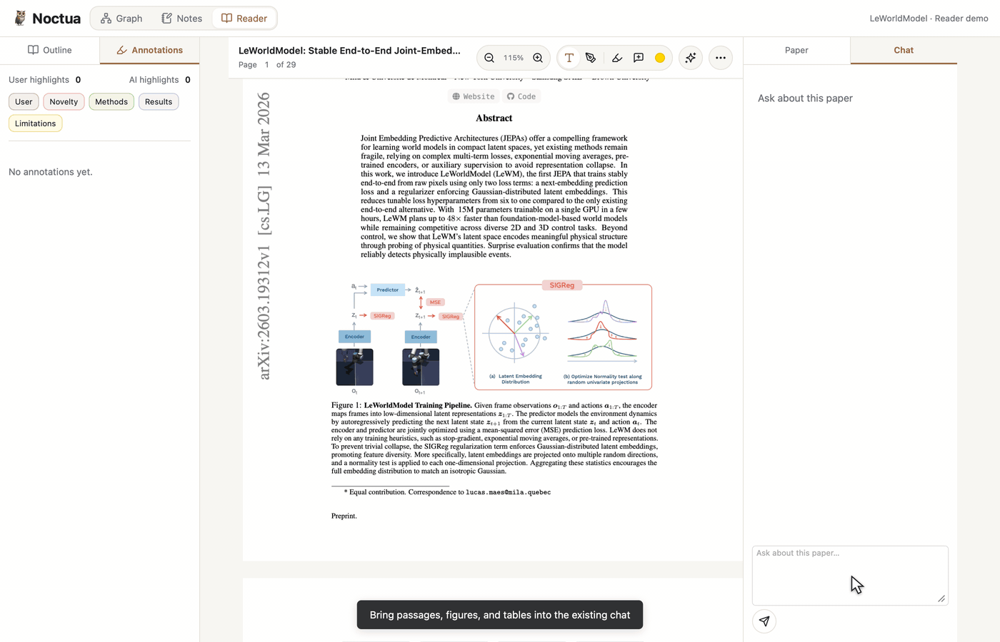

# Noctua 🦉

  
  
  

Explore research, read papers, and develop ideas in one local workspace.
Noctua brings together citation graphs, a PDF reader, LaTeX and handwritten
notes, and an optional assistant powered by Codex or Claude Code.

Available for **macOS (Apple Silicon), Windows, and Linux**, or in your browser.
Desktop and browser interfaces connect to an independent Noctua server on this
computer or another computer. The server stores your library, PDFs, notes and
chats and runs your assistant CLI. It keeps running when the desktop app closes.
Search papers with arXiv, Semantic Scholar, or OpenAlex; explore citation graphs
with Semantic Scholar.

[Get started](docs/getting-started.md) ·
[Release Note](https://github.com/UW-CTRL/noctua/releases)

For headless machines, see [standalone server downloads and installation](docs/server.md#standalone-installation).

*[Scripted demo](docs/pr-3.md) of source-aware chat attachments.*

## Use in a browser

No desktop installation is needed on the computer you browse from. Open a running
Noctua server’s address and sign in with its authentication token. A server must
already be running on this computer or another computer; Noctua does not provide
a hosted service. See [Browser quick start](docs/getting-started.md#use-in-a-browser-without-the-desktop-app)
for connecting and starting your own server.

## Main Features

- **Explore:** follow citation networks and research threads over time.
- **Organize:** collect papers, import PDFs, or bring in a Zotero library.
- **Read:** preview references, annotate papers, and generate AI outlines and highlights.
- **Write:** combine LaTeX, handwriting, and media with project files, imported bibliographies, and undo/redo.
- **Discuss:** ask questions about sources and review assistant edits before accepting them.

## Guides

[All documentation](docs/README.md)

| Topic | Guides |
| --- | --- |
| Research and reading | [Research](docs/research.md) · [PDF reader](docs/reader.md) |
| Writing and AI | [Notes](docs/notes.md) · [Research assistant](docs/assistant.md) · [AI prompts](docs/assistant.md#ai-prompts) |
| Server | [Connections and server operations](docs/server.md) |
| Settings and data | [Appearance, storage, and backups](docs/settings-and-data.md) |
| Development | [Build](docs/development.md) · [CI](docs/ci.md) · [Releasing](docs/releases.md) |

## License

[MIT](LICENSE). Bundled dependencies retain their own [licenses](web/vendor/).
