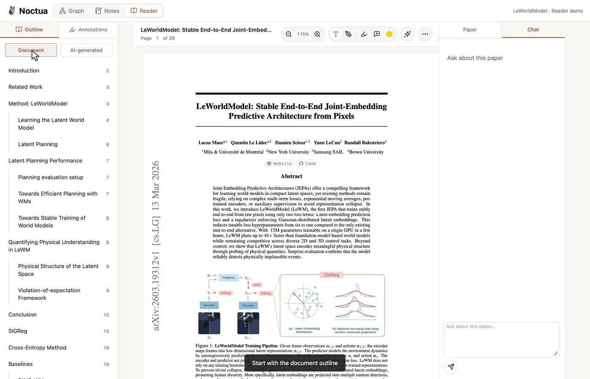
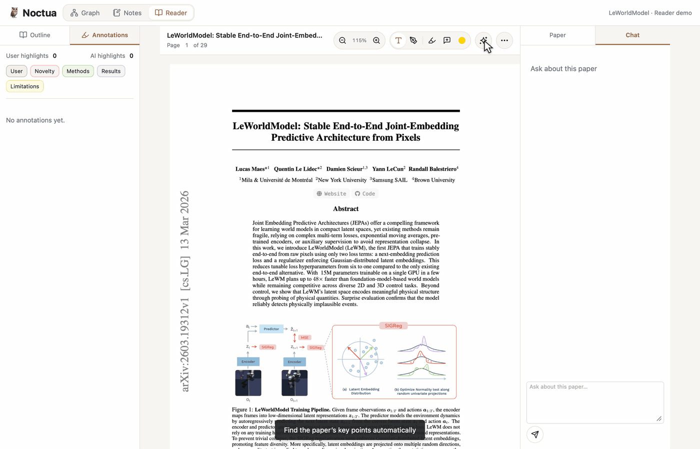
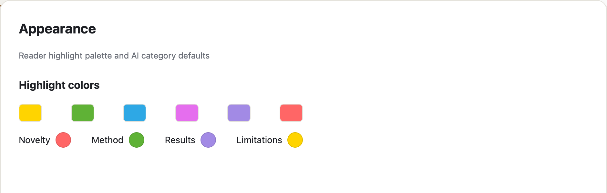

## Summary

Add AI-assisted PDF navigation and highlighting, clearer annotations, and source-aware chat attachments. Readers can navigate an inferred outline, identify the paper's key contributions, and bring selected passages or figures into the existing chat without losing their source locations.

This PR was stacked on #1 (`codex/settings-assistant-storage`), which is now merged. The Reader and attachment work remains on the existing PR branch.

## Main Features

### AI document outlines

Add **Outline** and **Annotations** tabs to the left Reader sidebar. Default to **Document** on the left. Keep **AI-generated** in a separate right-hand source selector; selecting it starts a grounded outline from selectable text, including inferred sections, or loads an existing saved result. A PDF without embedded bookmarks stays empty until the user chooses AI. Section entries navigate to the source passage. Support regeneration, retry, and a local cache keyed by the PDF hash. Place Regenerate on the left and an icon-only AI-outline delete control on the right; deleting the saved AI outline leaves document bookmarks and annotations intact.

### Categorized AI auto-highlights

Add an independent sparkle button beside the Reader's More menu. A dedicated worker with its own start prompt identifies **Novelty**, **Method**, **Results**, and **Limitations** using the configured Claude or Codex backend. It validates quoted passages before saving annotations, reuses cached analysis, and avoids duplicate highlights without replacing edited comments. Analysis runs in an ephemeral session and leaves the current chat history unchanged.

### Selected passages and PDF objects in chat

Drag text in PDFs, rendered notes, paper details, or chat messages and choose **Add to chat**. Queue multiple excerpts with a hover preview and individual removal. Numbered source badges and faint highlights identify pending attachments; drafts are stored per assistant and conversation, failed submissions retain them, and sent excerpts remain expandable in history. PDF text selection also offers six circles for saving a highlight immediately.

Hover over a detected **Figure**, **Table**, or **Algorithm** and click to attach it directly. Attachments carry captions, available text, and paper/page/region identifiers. Detection handles separate columns, spanning figures, long captions, stacked panels, image clipping, table rules, and rotated page watermarks. Visual interpretation uses the original page through `view_pdf_page`; attachments are not uploaded image crops. These controls use the existing Chat tab; no side chat is added.

### Readable annotations and configurable highlight colors

Keep highlight backgrounds behind original PDF text and graphics in light and dark modes. Join neighboring word rectangles without crossing line or column boundaries, and prevent overlapping highlights from accumulating opacity. Selecting an annotation adds an outline instead of darkening its fill. Keep native text selection and copying available.

Show separate User/AI highlight counts and category filters. Use compact cards with autosaving comments and an icon-only delete action. Remove Reply, Save, and Saved controls while retaining existing discussion history and suggestion acceptance. Preserve drafts and surface conflicting edits instead of silently overwriting them.

Expose six editable palette swatches and circular AI category pickers in Settings. AI categories can use only palette colors; changing a category or its palette slot recolors existing AI highlights and filters across the library. Existing user highlights keep their saved colors.

The three GIFs render the production Reader components with the user-selected LeWorldModel paper in an isolated recording fixture. The AI demos replay the approved analysis results saved by the live backend: 34 outline entries and 18 categorized highlights. They show the real UI lifecycle with the generation wait shortened; they are scripted demonstrations rather than a continuous browser screen recording. The attachment demo uses an isolated draft. No personal notes or chat history are loaded. The Settings image is the exact screenshot supplied for this PR.

To reproduce on macOS, place `paper.pdf`, `paper.json`, `index.json`, `outline.json`, and `annotations.json` in the ignored `target/pr3-recording/` directory. Run `swift tests/pr3-recordings.swift outline`, `swift tests/pr3-recordings.swift auto-highlight`, and `swift tests/pr3-recordings.swift attachments`, then `python3 tests/pr3-gifs.py` (FFmpeg required). The recording fixture only replays these local inputs; it does not call an AI provider or persist changes to the live library.

## Minor Changes

- Replace citation image previews with sorted `[number] Title` lists extracted locally from the bibliography, including grouped citations and ranges. Label unavailable entries rather than inventing titles.
- Open citation previews only on hover, not while dragging text. Use a smaller initial popup, support resizing and saved dimensions, and remove redundant close/navigation controls.
- Open external links directly in a new tab or the system browser. Remove external website hover previews and background captures; internal PDF links navigate directly.
- Keep the selected right-hand Paper/Chat tab across reloads without stealing focus.
- Align Outline/Annotations styling with the other sidebar tabs and scope tab handlers to their own navigation bars.
- Keep the AI highlight toolbar button separate from manual annotation tools. Remove unnecessary hover flashing from AI category labels.
- Position attachment badges in PDF margins and keep both text and object attachment fills faint.
- Fix the annotation-chip icon and prevent note-edit mode from opening when text is selected for attachment.
- Update README, note help, shared assistant guides, and the `annotate_pdf` category/color schema together. Distinguish UI-only controls from available assistant tools.

## Validation

- **Passed:** `cargo test --offline --locked -p noctua` — 29 tests, including isolated analysis sessions, quote grounding, caching, atomic annotation writes, palette migration/recoloring, and selected passages reaching both assistants and saved history.
- **Passed:** Swift checks for frontend syntax/backend switching, PDF navigation and bibliography matching, continuous/non-stacking highlights, palette controls, and captioned object detection.
- **Passed:** `node tests/pdf-comments.cjs` — debounce, serialized saves, tab-close flushing, revision conflicts, offline recovery, and deletion during a save.
- **Passed:** isolated WebKit recording fixtures for outline generation/navigation (7 steps), auto-highlighting/category review (9 steps), and text/figure/table attachments (14 steps). All three GIFs were encoded, decoded, and visually checked.
- **Passed:** approved live-backend analysis on LeWorldModel — 34 grounded outline entries and 18 saved AI highlights.
- **Checked:** PDF geometry on LeWorldModel (19 figures and 9 tables) and SmoothQuant (10 figures and 11 tables), including SmoothQuant's actual Reader text geometry.
- **Passed:** whitespace and English-language audits of changed source, UI text, documentation, prompts, and fixtures.
- **Not counted as passing:** the full `tests/pdf-reader.html` WebKit integration suite timed out in this environment.

## Limits

AI analysis requires selectable text, supports up to 400 pages, and uses bounded excerpts for long documents. It does not OCR scans or analyze figure images during auto-highlighting. Object detection remains heuristic for unusual layouts. Chat attachments are limited to 20 passages, 12,000 characters each, and 40,000 characters total.

## Commit Organization

1. `Add grounded AI PDF outlines and categorized auto-highlights`
2. `Improve PDF highlights, annotation editing, colors, and citation navigation`
3. `Attach selected passages and detected PDF objects to chat`
4. `Document Reader features with isolated English demo screenshots`
